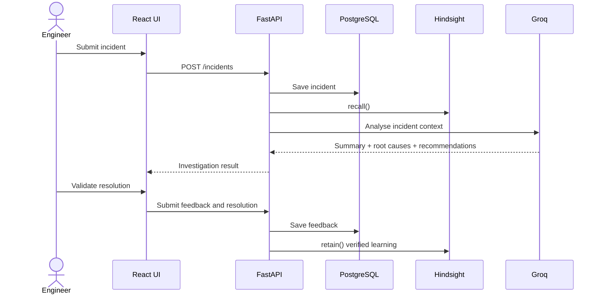

# Technical Architecture Specification

## 1. System overview
IncidentIQ is a module-based monolith for production incident investigation and learning. The system has a React frontend, FastAPI backend, PostgreSQL operational database, Hindsight memory layer, and Groq LLM integration.

The product follows a learn-from-experience lifecycle: every incident is submitted, analysed, compared against prior memory, reviewed by engineers, and then retained as learning when the outcome is verified.

## 2. Architectural principles
1. Hindsight is mandatory and central.
2. PostgreSQL stores operational and auditable records.
3. Hindsight stores contextual memory, not raw DB duplication.
4. AI recommendations must be evidence-linked and transparent.
5. Only verified outcomes become memory.
6. The product remains a modular monolith for the hackathon stage.

## 3. Technology stack
### Frontend
- React + Vite
- Tailwind CSS
- Axios
- Lucide React
- Recharts

### Backend
- Python
- FastAPI
- Uvicorn
- Pydantic
- SQLAlchemy

### Database
- PostgreSQL

### AI
- Groq API

### Memory
- Hindsight SDK with `retain()` and `recall()`

## 4. High-level architecture
```text
React Frontend   --->   FastAPI Backend   --->   PostgreSQL
      |                              |
      |                              +---> Hindsight Memory
      |                              |
      +------------------------------+---> Groq API
```

Frontend responsibilities:
- dashboard
- incident submission
- investigation center
- postmortem center
- memory inspector

Backend responsibilities:
- API routing
- validation
- orchestration
- Postgres access
- Hindsight access
- Groq interaction

## 5. Frontend architecture
The frontend layer is organized around four main operational pages and demo support.

### Pages
- Dashboard
- Investigation Center
- Memory Inspector
- Postmortem Center
- Guided Demo

### State model
- local UI state for form and navigation
- API-driven state for incidents and memory
- shared loading and error handling

## 6. Backend architecture
The backend is a modular monolith. Key domains:
- incident_service
- investigation_service
- memory_service
- feedback_service
- analytics_service
- postmortem_service
- demo_service

### API layer
- validates incoming requests
- transforms DTOs
- calls services
- returns JSON responses

### Business layer
- incident submission workflow
- AI investigation workflow
- memory recall and retention
- postmortem generation
- analytics and recurrence checks

## 7. AI agent architecture
IncidentIQ uses an AI agent pattern but not as a generic chat assistant. It is a structured investigation engine.

Inputs:
- current incident metadata
- logs
- deployment context
- historical incident matches
- Hindsight memory

Outputs:
- incident summary
- likely root causes
- evidence-based recommendations
- warnings for repeated failure paths
- memory comparison result

Important rule: model output is not treated as confirmed truth without validation.

## 8. Hindsight memory architecture
Hindsight is a required memory layer. It stores the operational knowledge that should survive across incidents.

### Memory categories
- incident memory
- resolution memory
- failure memory

### Standard operations
- `retain()` stores verified lessons
- `recall()` searches the memory layer for relevant context

### Separation of concerns
- PostgreSQL: operational system of record
- Hindsight: contextual AI memory

### Evidence provenance model
Every recommendation carries source provenance. The application explicitly distinguishes:
1. current incident evidence
2. Hindsight historical memory
3. AI-generated hypothesis
4. engineer-verified root cause

A historical incident may support a recommendation but cannot be treated as proof of the current root cause without verification.

## 9. Groq integration
Groq is used for summarisation and reasoning. The backend sends structured prompts with incident, log, and historical memory context and receives a constrained analysis and recommendation payload.

Requirements:
- validate SDK and model availability against official docs
- avoid sending secrets or raw credentials
- do not present a model guess as verified fact

## 10. PostgreSQL integration
PostgreSQL stores the following records:
- incidents
- investigation_runs
- incident_logs
- deployments
- postmortems
- engineer_feedback
- memory_operation_events

These tables provide lifecycle traceability, evidence storage, and postmortem persistence. `investigation_runs` is required to support multiple analyses of the same incident and to preserve the memory-mode audit trail.

## 11. Complete incident lifecycle


## 12. Memory Off vs Memory On workflow
The system creates two controlled investigation paths that share the same current incident evidence and comparable model settings:
- memory off: current incident data only; no Hindsight recall is executed.
- memory on: same incident data plus a real Hindsight recall and relevant memory references passed to Groq.

Both paths create separate `investigation_runs` records so the UI can compare the recommendation provenance and the historical evidence used. The product must not claim improved confidence or MTTR without measured data.

## 13. Feedback and learning workflow
Feedback is captured after recommendation review.
- accept
- reject
- correct

When a final outcome is verified, the backend retains the lesson in Hindsight and records the memory event in PostgreSQL.

## 14. Memory conflict detection workflow
Conflict detection compares historical memory and current evidence.

If memory conflicts with present evidence, the system:
- flags the conflict
- surfaces the contradiction in the UI
- requests validation before trust is increased
- keeps the contradiction separate from a verified root cause

## 15. Failure-aware recommendation workflow
Before recommending a mitigation, the system checks prior failure memory.

If a similar action previously failed, the UI shows a warning that the action is risky or previously unsuccessful.

## 16. Guided demo architecture
Demo mode uses synthetic incidents and explicit labelling.

Key characteristics:
- synthetic incident generator
- memory-off and memory-on comparison
- clear “synthetic” labels
- guided narrative steps

## 17. Postmortem generation architecture
Once a resolution is verified, the backend assembles:
- summary
- impact
- root cause
- evidence
- prevention steps
- lessons learned

It then writes a markdown document to PostgreSQL and makes it available for download.

## 18. Data flow diagrams
```mermaid
flowchart LR
    A[Incident]
    A --> B[Validation]
    B --> C[Store in PostgreSQL]
    B --> D[Retrieve Similar History]
    D --> E[Recall Hindsight Memory]
    E --> F[Groq analysis]
    F --> G[Recommendations]
    G --> H[Engineer Feedback]
    H --> I[retain() verified learning]
    I --> J[Future Investigations]
```

## 19. Folder structure
```text
hackwithbanglore/
├── project-docs/
│   ├── PRD.md
│   ├── DESIGN.md
│   ├── ARCHITECTURE.md
│   ├── DATABASE.md
│   ├── API.md
│   ├── AGENTS.md
│   ├── IMPLEMENTATION_PLAN.md
│   └── HACKATHON_REQUIREMENTS.md
├── backend/
│   ├── app/
│   ├── migrations/
│   └── requirements.txt
├── frontend/
│   ├── src/
│   └── package.json
├── README.md
└── .env.example
```

## 20. Configuration strategy
- environment variables for secrets and endpoints
- local configuration separate from production-like setup
- validation for model config and DB connections

## 21. Environment variables
- POSTGRES_URL
- GROQ_API_KEY
- HINDSIGHT_API_KEY
- APP_ENV
- DEBUG_MODE

## 22. Security boundaries
- frontend never stores secrets
- backend owns external credentials
- API contract never leaks internal secrets
- logging redacts sensitive values

## 23. Error handling
- validation errors: show user-safe messages
- Groq failure: degrade gracefully
- Hindsight failure: show warning and preserve investigation flow
- database failure: show error without exposing internals

## 24. Logging
Logs should include:
- incident ID
- operation name
- timestamp
- status
- error summary if any

Sensitive values must be redacted before writing logs.

## 25. Testing strategy
- backend unit tests for logic and validation
- API integration tests for endpoints
- database migration tests
- Hindsight integration smoke tests
- frontend smoke tests for critical flows

## 26. Local development
- local PostgreSQL instance
- local FastAPI server
- local Vite frontend
- real Hindsight verification before final demo

## 27. Deployment strategy
The project is designed for a local-first MVP with an optional public demo layer. A realistic free-tier approach is:
- Frontend hosting: Vercel or Netlify free tier
- Backend hosting: Render free tier or Railway free tier
- PostgreSQL: Supabase free tier or Neon free tier
- Hindsight connectivity: validated via environment variables and documented SDK connection
- Groq: open API key configuration verified against official docs
- CORS: allow only the configured frontend origin
- HTTPS: required for public hosting
- Secret management: environment variables only, never committed to the repository
- Health checks: `/health` endpoint and dependency checks for Postgres, Hindsight, and Groq
- Deployment smoke tests: startup health, one incident creation flow, one memory recall flow, and one memory-off/memory-on comparison

Local fallback remains supported for offline or restricted demo environments. Free hosting is not guaranteed and must be verified during deployment.

## 28. MVP architecture
MVP includes:
- incident submission
- AI investigation
- memory recall and retention
- dashboard
- memory inspector
- postmortem generation
- demo mode

## 29. Future scalability
Potential future improvements include advanced analytics, stronger role control, and better memory metadata. These should be added only after the core Hindsight loop is stable.

## 30. Summary
IncidentIQ is a modular monolith built around evidence, memory, and learning. PostgreSQL provides traceability, Groq provides reasoning, and Hindsight provides persistent learning across incidents. The product’s core value is not just AI-generated insight—it is the ability to retain verified operational lessons and apply them to future investigations.
