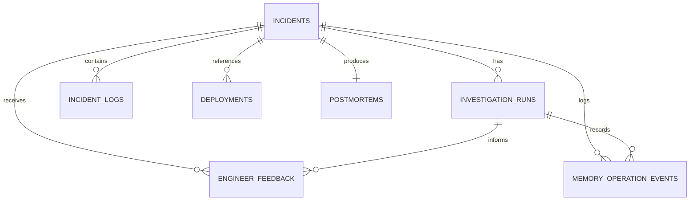

# PostgreSQL Database Design

## 1. Database purpose
The PostgreSQL database is the structured system of record for IncidentIQ. It stores operations, incident history, logs, deployment metadata, feedback, postmortems, and memory audit records.

Hindsight stores the contextual memory layer. PostgreSQL stores the operational facts and history that the team needs for traceability and compliance.

## 2. Design principles
- no duplication of Hindsight memory as primary source of truth
- keep operational metadata explicit and auditable
- store status transitions and timestamps
- use structured, normalised relationships
- keep synthetic data clearly labelled

## 3. incidents table
### Purpose
Stores the canonical record for each incident.

### Columns
| Column | Type | Null | Notes |
|---|---|---:|---|
| id | UUID | No | PK |
| incident_number | VARCHAR(32) | No | unique human-readable code |
| title | VARCHAR(255) | No | short incident summary |
| description | TEXT | No | detailed incident narrative |
| service_name | VARCHAR(150) | No | affected service |
| environment | VARCHAR(50) | No | prod, staging, dev |
| severity | VARCHAR(20) | No | critical, high, medium, low |
| status | VARCHAR(30) | No | open, investigating, resolved, closed |
| owner | VARCHAR(150) | Yes | responsible engineer |
| source | VARCHAR(50) | No | web, api, demo |
| created_at | TIMESTAMPTZ | No | created timestamp |
| updated_at | TIMESTAMPTZ | No | last update |
| resolved_at | TIMESTAMPTZ | Yes | timestamp when incident resolved |
| root_cause_summary | TEXT | Yes | verified root cause |
| synthetic_data | BOOLEAN | No | true for demo data |
| is_demo | BOOLEAN | No | demo flag |

### Constraints
- `severity` must match the approved enumeration
- `status` must be valid
- `incident_number` unique
- `created_at <= updated_at`

### Relationships
- one incident has many logs
- one incident has many investigation runs
- one incident has many feedback entries
- one incident may have many deployments
- one incident may have one postmortem

## 4. investigation_runs table
### Purpose
Tracks each analysis execution for an incident, including memory mode and execution metadata. This supports multiple investigations of the same incident while retaining traceability.

### Columns
| Column | Type | Null | Notes |
|---|---|---:|---|
| id | UUID | No | PK |
| incident_id | UUID | No | FK to incidents.id |
| memory_mode | VARCHAR(20) | No | off or on |
| model_identifier | VARCHAR(200) | Yes | model name or version as provided by Groq |
| analysis_summary | TEXT | Yes | summary returned by the investigation |
| recalled_memory_refs | JSONB | Yes | safe references to recalled memories, such as IDs or metadata |
| execution_status | VARCHAR(30) | No | queued, running, succeeded, failed, partial |
| created_at | TIMESTAMPTZ | No | execution timestamp |

### Constraints
- valid `memory_mode` values: `off`, `on`
- valid `execution_status` values: `queued`, `running`, `succeeded`, `failed`, `partial`
- `incident_id` must reference an existing incident
- `recalled_memory_refs` must contain only safe metadata and references, not raw memory payloads

### Relationships
- many investigation_runs belong to one incident
- one investigation_run may have many memory operation events
- one investigation_run may be referenced by many feedback rows

## 5. incident_logs table
### Purpose
Stores incident timeline information and raw logs.

### Columns
| Column | Type | Null | Notes |
|---|---|---:|---|
| id | UUID | No | PK |
| incident_id | UUID | No | FK to incidents.id |
| log_type | VARCHAR(40) | No | error, warning, deployment, note |
| log_text | TEXT | No | log excerpt or note |
| source_system | VARCHAR(100) | Yes | application or infrastructure |
| created_at | TIMESTAMPTZ | No | log timestamp |
| author | VARCHAR(150) | Yes | reporter or system |

### Constraints
- valid `incident_id`
- no raw credential text allowed

## 6. deployments table
### Purpose
Tracks deployment metadata associated with an incident.

### Columns
| Column | Type | Null | Notes |
|---|---|---:|---|
| id | UUID | No | PK |
| incident_id | UUID | No | FK to incidents.id |
| deployment_id | VARCHAR(100) | Yes | external release id |
| environment | VARCHAR(50) | No | target environment |
| service_name | VARCHAR(150) | No | affected service |
| version | VARCHAR(100) | Yes | release version |
| deployed_by | VARCHAR(150) | Yes | operator or system |
| deployed_at | TIMESTAMPTZ | No | deployment timestamp |
| change_summary | TEXT | Yes | summary of change |
| created_at | TIMESTAMPTZ | No | row creation time |

### Constraints
- valid incident reference
- valid deployment timestamp

## 7. postmortems table
### Purpose
Stores generated markdown postmortem reports.

### Columns
| Column | Type | Null | Notes |
|---|---|---:|---|
| id | UUID | No | PK |
| incident_id | UUID | No | FK to incidents.id |
| title | VARCHAR(255) | No | report title |
| body_markdown | TEXT | No | output markdown |
| status | VARCHAR(30) | No | draft, final, archived |
| generated_by | VARCHAR(100) | Yes | system or engineer |
| created_at | TIMESTAMPTZ | No | generation timestamp |
| updated_at | TIMESTAMPTZ | No | last update |
| downloaded_count | INTEGER | No | number of downloads |

### Constraints
- postmortem generation only for verified incident
- body_markdown must not be empty
- one final postmortem per incident is enforced by a unique partial index on `incident_id` where `status = 'final'`
- additional draft/revision rows may be created for history, but the final report remains unique

## 8. engineer_feedback table
### Purpose
Requests and stores engineer review of AI recommendations and investigation runs.

### Columns
| Column | Type | Null | Notes |
|---|---|---:|---|
| id | UUID | No | PK |
| incident_id | UUID | No | FK to incidents.id |
| investigation_run_id | UUID | Yes | FK to investigation_runs.id when the feedback references a run |
| recommendation_id | VARCHAR(100) | Yes | recommendation identifier or safe reference only |
| feedback_type | VARCHAR(30) | No | accepted, rejected, corrected |
| comment | TEXT | Yes | engineer rationale |
| confidence | NUMERIC(3,2) | Yes | optional confidence value |
| created_at | TIMESTAMPTZ | No | timestamp |
| created_by | VARCHAR(150) | No | reviewer identity |

### Constraints
- valid feedback type
- valid incident reference
- `investigation_run_id` is optional but, if present, must reference a valid investigation run
- `recommendation_id` must be a safe, documented identifier and must not be an arbitrary raw model output blob

## 9. memory_operation_events table
### Purpose
Stores audit events for Hindsight operations and memory-related decisions.

### Columns
| Column | Type | Null | Notes |
|---|---|---:|---|
| id | UUID | No | PK |
| incident_id | UUID | Yes | FK to incidents.id |
| investigation_run_id | UUID | Yes | FK to investigation_runs.id when relevant |
| operation_name | VARCHAR(50) | No | retain, recall, conflict_detected |
| memory_type | VARCHAR(50) | No | incident, resolution, failure |
| status | VARCHAR(20) | No | success, failed, partial |
| payload_summary | TEXT | Yes | safe metadata summary only |
| created_at | TIMESTAMPTZ | No | event timestamp |
| error_message | TEXT | Yes | redacted error details only |

### Constraints
- valid status and operation names
- `investigation_run_id`, when present, must reference a valid investigation_run
- no raw credentials or raw memory payloads in `payload_summary`
- `error_message` must be redacted and minimal

## 10. Entity relationship diagram

## 11. Index strategy
Recommended indexes:
- incidents(status, severity, created_at)
- incidents(service_name, environment, created_at)
- investigation_runs(incident_id, created_at)
- investigation_runs(incident_id, memory_mode, execution_status)
- incident_logs(incident_id, created_at)
- deployments(incident_id, deployed_at)
- engineer_feedback(incident_id, created_at)
- engineer_feedback(investigation_run_id, created_at)
- postmortems(incident_id, created_at)
- memory_operation_events(incident_id, operation_name, created_at)
- memory_operation_events(investigation_run_id, created_at)

## 12. Query patterns
- incident dashboard totals and recent incidents
- service-specific incident history
- investigation history for a single incident and memory mode
- timeline logs for a single incident
- deployment context matching incident time windows
- recurrence lookups and memory audit checks
- postmortem retrieval for closed incidents

## 13. Validation rules
- severity must be one of approved options
- title and description cannot be empty
- generated postmortem requires verified resolution
- memory events must track status explicitly
- synthetic rows must be flagged

## 14. Timestamp handling
All timestamps should use `TIMESTAMPTZ` to avoid timezone ambiguity and to support timeline ordering across environments.

## 15. Migration strategy
- create schema incrementally
- add constraints after validation
- maintain an explicit migration history
- prefer additive changes over destructive modifications

## 16. Seed-data strategy
Seed data is permitted only for demo scenarios. It must be labelled as synthetic and should not be mixed with production-ready records in a live environment.

## 17. Synthetic-data labelling
Synthetic records must set the following values:
- `synthetic_data = true`
- `is_demo = true`
- clear UI labeling in dashboard and demo flows

## 18. Backup and recovery
- schedule backups for the database
- ensure restore validation is part of operational readiness
- protect postmortem and incident records as core business data

## 19. PostgreSQL vs Hindsight
### PostgreSQL stores
- incidents
- logs
- deployments
- feedback
- postmortems
- memory operation events

### Hindsight stores
- incident memory
- resolution memory
- failure memory
- contextual relationships across incidents

This separation keeps PostgreSQL accountable for operational history and keeps Hindsight focused on learning and recall.

## 20. Data integrity notes
- never store secrets in logs or postmortems
- do not duplicate full Hindsight memory into PostgreSQL as a second primary store
- keep memory operation events as audit only, not as a hidden source of truth

## 21. Summary
The PostgreSQL schema is intentionally small but robust. It supports a reliable lifecycle for incidents, evidence, and documentation while allowing Hindsight to remain the dedicated memory layer for learning and recall.
